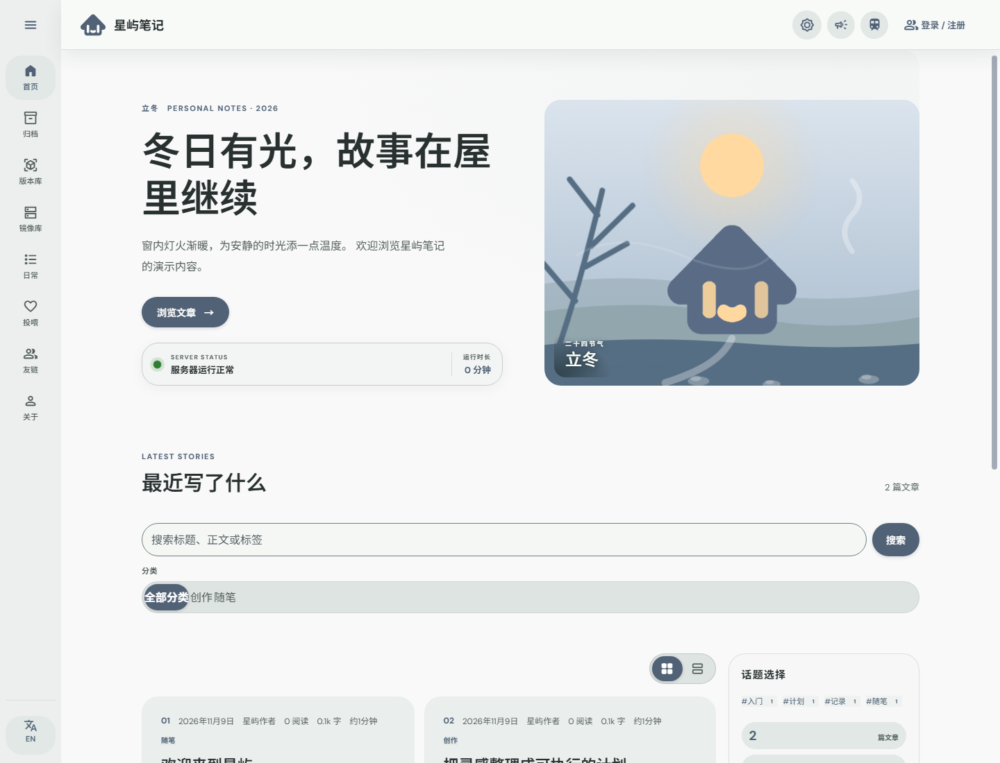
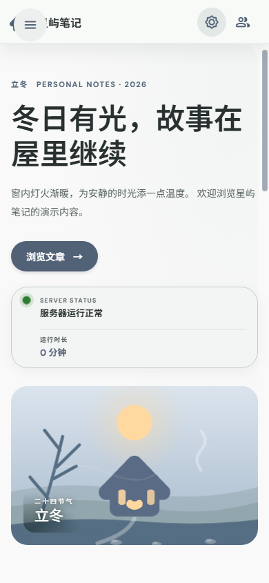

# Meterial Extra

一个基于 Material 3 的个人内容站点模板，包含访客网站、独立管理端和轻量 Python 服务端。界面与数据均为重新生成的演示内容，不包含原部署实例的文章、用户、图片、账号、接口地址或服务器配置。

<p align="center">
  <a href="https://github.com/shawnhoa/meterial-extra/releases/tag/v0.1.1">下载 v0.1.1</a> ·
  <a href="https://github.com/shawnhoa/meterial-extra">源代码</a>
</p>

## 预览

线上部署示例：[星屿笔记站点所有者的实例](https://shawnho.top/)。该站点内容与本仓库无关，不会被复制到演示数据中。仓库预览图展示的是重新生成的演示界面。





## 功能

- Material 3 风格访客端，支持文章归档、搜索、分类、标签、公告、友链和个人资料页。
- 独立管理端，支持文章编辑、站点外观配置、公告维护、评论审核、用户管理、举报与友链申请处理。
- 多主题、明暗模式、中英文界面和响应式布局。
- Python 标准库 HTTP 服务端，数据保存在单独的数据目录；图片上传与富文本内容提供服务端校验。
- Docker Compose 部署和 Windows、Linux/macOS 启动脚本。

## 快速开始

需要 Python 3.10+。Linux/macOS：

```sh
cp .env.example .env
sh run.sh
```

Windows PowerShell：

```powershell
Copy-Item .env.example .env
.\run.ps1
```

先在 `.env` 中设置 `ADMIN_USERNAME` 与至少 16 位的 `ADMIN_PASSWORD`。访客端默认监听 `http://localhost:8080`，管理端默认监听 `http://localhost:8081/admin`。本地脚本将管理端绑定到回环地址；生产部署应通过 HTTPS 反向代理和访问控制保护管理端。

## Docker

```sh
cp .env.example .env
docker compose up --build -d
```

Compose 将应用数据写入本地 `./data`，并只把管理端映射到本机回环接口。部署前请设置强管理员密码；需要远程管理时，请在反向代理层配置 HTTPS 与访问控制，并为数据目录设置备份和访问权限。

## 配置

环境变量见 [`.env.example`](./.env.example)。管理密码、SMTP 凭据、OAuth 密钥和验证码服务密钥只能放在本地 `.env` 或部署环境中，不能写入前端代码或提交到仓库。模板不配置任何第三方服务账号；未配置时，相应能力保持关闭。

API 路由是此模板前后端配套使用的示例接口。对接自有服务时请从 `app/blog.py`、`app/app.js` 与 `app/admin.js` 中按需修改。

## 项目结构

```text
app/                 访客端、管理端、主题资源与 Python 服务端
data/                运行时数据目录（不纳入版本控制）
run.sh               Linux/macOS 启动脚本
run.ps1              Windows 启动脚本
compose.yaml         Docker Compose 配置
Dockerfile           容器构建文件
```

## 生产部署实例

本主题的部署实例可由项目所有者自行引用真实站点与截图。该站点仅作为外观和部署参考，任何站点专属文字、接口、图片与用户数据都不属于本模板。

## 版本

### v0.1.1

- 修复关于页引用缺失角色素材和页脚演示备案资源的问题。
- 刷新桌面端演示截图，并更新发布归档。

### v0.1.0

- 从阿里云部署项目的访客端与管理端结构整理出通用模板。
- 清除原实例的专属内容、外部身份信息、运行配置和用户数据。
- 提供本地启动、容器部署及源码归档包。

## License

代码采用 MIT License。第三方字体、图标和依赖仍受各自许可约束，详见其上游项目。
