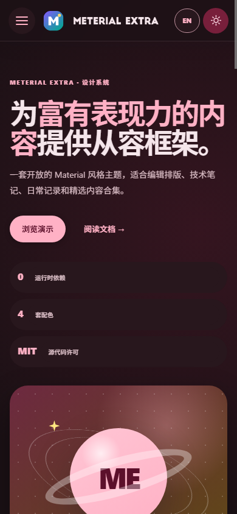

<p align="center">
  <picture>
    <source media="(prefers-color-scheme: dark)" srcset="./docs/images/wordmark-dark.png">
    <source media="(prefers-color-scheme: light)" srcset="./docs/images/wordmark-light.png">
    
  </picture>
</p>

<p align="center">面向表达型内容的开放 Material 风格主题与前端框架。</p>

<p align="center">
  <a href="./README.md">English</a> | 简体中文
</p>

<p align="center">
  <a href="https://github.com/shawnhoa/meterial-extra/actions/workflows/deploy-pages.yml"></a>
  <a href="./LICENSE"></a>
  
  
</p>

<p align="center">
  <a href="https://shawnhoa.github.io/meterial-extra/"><strong>在线演示</strong></a>
  ·
  <a href="DEPLOYMENT.md"><strong>部署指南</strong></a>
  ·
  <a href="https://github.com/shawnhoa/meterial-extra/releases"><strong>版本发布</strong></a>
</p>

## 项目简介

**Meterial Extra** 是一个无运行时依赖、无需构建步骤的 Material 风格主题和响应式前端框架。它提供语义化设计令牌、多套配色、深浅模式、可调圆角、宽屏侧栏、竖屏抽屉、文章卡片、话题筛选和完整的中英文演示。

本仓库只包含重新生成的演示内容。实际使用者的文章、账号、评论、上传图片、服务器地址和生产配置不会被收录。

## 开源范围

| 已公开 | 不公开 |
| --- | --- |
| 响应式布局与生成页面 | 生产环境内部接口或管理端点 |
| 主题、导航、搜索、筛选与配色控件 | 数据库、账号、会话或密钥 |
| API 请求封装与配置示例 | 原始文章、私有图片或用户上传资源 |
| 运行、部署与打包脚本 | 任何生产服务器密钥 |


## 界面预览

<table>
  <tr>
    <td width="72%"></td>
    <td width="28%"></td>
  </tr>
  <tr>
    <td align="center">桌面端：宽屏侧栏、主题配色与内容布局</td>
    <td align="center">移动端：中文界面与紧凑页眉</td>
  </tr>
</table>

### 生产部署示例

实际使用 Meterial Extra 的站点：[ShawnHo 的小屋](https://shawnho.top/)

## 在线演示与真实部署

- GitHub Pages 演示：https://shawnhoa.github.io/meterial-extra/
- 生产部署成功案例：[ShawnHo 的小屋](https://shawnho.top/)

生产站点仅作为成功使用 Meterial Extra 的示例。其文章、账号、图片和服务器配置不属于本开源仓库。

## 功能特性

- **Material 语义令牌**：统一描述颜色、表面、文字、描边、阴影和圆角。
- **四套配色**：丁香紫、玫瑰红、海洋蓝、苔藓绿，均支持深浅模式。
- **中英双语**：演示界面、文章标题、摘要、分类、话题和统计信息均可实时切换。
- **响应式导航**：宽屏使用固定侧栏，窄屏与竖屏使用紧凑抽屉。
- **圆角安全区**：标签、胶囊、按钮与卡片的文字会随圆角预设自动保留内边距。
- **文章与话题筛选**：支持搜索、分类、话题和演示统计数据。
- **无障碍基础**：键盘焦点、语义标签、ARIA 状态与减少动态效果偏好。
- **零运行时依赖**：浏览器直接加载 CSS 和原生 JavaScript 模块。
- **多种部署方式**：支持 GitHub Pages、静态服务器、Nginx 和 Docker。

## 快速开始

```bash
git clone https://github.com/shawnhoa/meterial-extra.git
cd meterial-extra
npm start
```

Windows：

```powershell
.\run.ps1
```

Linux / macOS：

```bash
sh run.sh
```

访问 `http://localhost:4173`。

项目没有安装依赖或生产构建步骤。任意静态服务器都可以直接发布仓库根目录。

## 运行检查

```bash
# 检查必要文件、语法与外部链接
npm run check

# 桌面端、移动端、中文切换和主题切换视觉检查
npm run visual
```

视觉检查依赖本机 `http://127.0.0.1:9222` 暴露的 Chromium/Edge DevTools 调试端口。

## 部署方法

完整的部署说明见 [DEPLOYMENT.md](DEPLOYMENT.md)。

### GitHub Pages

1. 打开仓库 **Settings → Pages**。
2. 将发布源设为 **GitHub Actions**。
3. 推送至 `main` 分支。
4. 等待 `Deploy demo to GitHub Pages` 工作流完成。

### Nginx

```nginx
server {
    listen 80;
    server_name example.com;
    root /var/www/meterial-extra;
    index index.html;

    location / {
        try_files $uri $uri/ =404;
    }
}
```

### Docker

```bash
docker build -t meterial-extra .
docker run --rm -p 8080:80 meterial-extra
```

打开 `http://localhost:8080`。

## 接口与配置

公开仓库不包含生产站点的内部接口、文章、账号或图片。接口仅以模板形式提供：

- `config.js`：当前公开运行配置
- `config.example.js`：连接自己服务时的配置示例
- `src/js/api.js`：请求封装、路径参数与请求头模板
- [API_TEMPLATE.md](API_TEMPLATE.md)：接口路径、响应结构和安全边界

默认模式使用全新的生成内容。配置自己的接口时，请复制 `config.example.js` 的结构到 `config.js`，并根据后端字段修改 `src/js/api.js`。密码、数据库连接、私钥、管理 Token 和内部接口不得写入前端代码。

`config.example.js` 中的接口地址仅为占位值，运行演示不需要准备任何后端服务。

## 打包发布

```bash
# 跨平台 tar.gz
npm run package

# Windows zip
powershell -ExecutionPolicy Bypass -File scripts/package-release.ps1
```

发布包包含源码、生成演示内容、运行脚本、Nginx/Docker 配置和接口模板，输出至 `dist/`。

也可以直接从 [GitHub Releases v0.1.0](https://github.com/shawnhoa/meterial-extra/releases/tag/v0.1.0) 下载 ZIP 或 TAR.GZ。

## 项目结构

```text
.github/workflows/   GitHub Pages 自动部署
docs/images/         README 演示截图与字标
public/assets/       演示 Logo 和原创 SVG 插图
src/css/tokens.css   颜色、圆角与尺寸令牌
src/css/theme.css    基础主题与通用控件
src/css/site.css     演示页面与响应式布局
src/data/demo.js     中英文虚构演示内容
src/js/theme.js      主题、配色与导航 API
src/js/app.js        演示交互与语言切换
scripts/             本地服务器、检查与视觉测试
config.js            公开运行配置
config.example.js    接口配置模板
API_TEMPLATE.md      接口契约与安全说明
run.ps1 / run.sh     跨平台启动脚本
```

## 自定义

1. 替换 `src/data/demo.js` 中的演示内容。
2. 在 `src/css/tokens.css` 中修改配色和圆角。
3. 替换 `public/assets/logo.svg` 为自己的标志。
4. 根据自身字体授权替换主题名称字标。
5. 更新页脚、GitHub 链接和生产示例。

## 字体与品牌资源

主题名称直接使用仓库中包含的 **Big John Regular** 字体。项目所有者已确认该字体可免费商用、可再分发且无版权争议。

字体署名仍归作者 Ion Lucin 所有。详细说明见 [BRAND_ASSET_LICENSE.md](BRAND_ASSET_LICENSE.md)。

## 参与贡献

欢迎提交 Issue 和 Pull Request。新增内容必须为原创或获得授权的演示内容，不应包含任何真实站点的个人数据、凭据或生产配置。

请阅读 [CONTRIBUTING.md](CONTRIBUTING.md) 和 [CODE_OF_CONDUCT.md](CODE_OF_CONDUCT.md)。

## License

源代码与文档采用 [MIT License](LICENSE)。第三方商标、字体和单独声明的品牌资源不自动适用 MIT License。

## Star History

<a href="https://star-history.com/#shawnhoa/meterial-extra&Date">
  <picture>
    <source media="(prefers-color-scheme: dark)" srcset="https://api.star-history.com/svg?repos=shawnhoa/meterial-extra&type=Date&theme=dark" />
    <source media="(prefers-color-scheme: light)" srcset="https://api.star-history.com/svg?repos=shawnhoa/meterial-extra&type=Date" />
    
  </picture>
</a>
